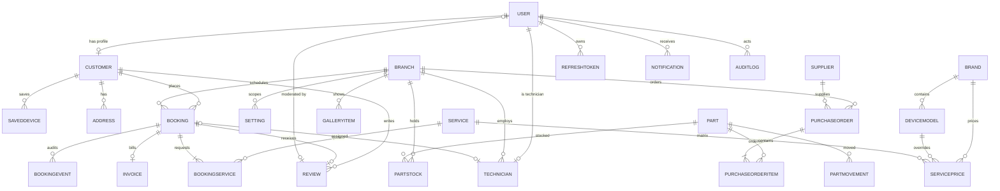

# Database Design — MobileFix Pro

> Source of truth: [`../prisma/schema.prisma`](../prisma/schema.prisma) (PostgreSQL via Prisma). This doc explains the shape, conventions, and reasoning. Any divergence from the `.prisma` file is a bug — fix the schema.

---

## 1. Conventions

| Rule | Convention |
|---|---|
| IDs | `cuid()` (`String @id @default(cuid())`) — globally unique, non-sequential, DB-server-safe. |
| Public references | Never expose cuid in public URLs. Bookings use `bookingRef` (`MF-YYYYMMDD-XXXXX`); invoices `INV-YYYYMMDD-0001`; POs `PO-YYYYMMDD-0001`. |
| Money | `Int` in **minor units** (cents/paise). `taxRateBps` is basis points (`1800` = 18%). See [memory.md D-005](memory.md). |
| Time | All columns `DateTime` (Prisma maps to `timestamptz`). UTC storage; display in branch timezone. |
| Multi-branch | Every business record has `branchId` (FK + index). `Setting` scopes `GLOBAL` or `BRANCH`. |
| Soft delete | Only `User`/`Customer` get `isActive` (history retention). Everything else hard-deletes. |
| Booleans | `isActive`, `isWalkIn`, `featured`, etc. — explicit prefix. |
| Arrays | Postgres native arrays for `String[]` (images, tags, skills). |

### Index policy
- Every FK is indexed (`@@index`), plus composite indexes for the hot query shapes:
  - `Booking`: `(branchId, status)`, `(branchId, scheduledAt)`, `(customerId)`, `(technicianId)`, `bookingRef` unique.
  - `ServicePrice`: `(brandId, modelId)` + unique `(serviceId, brandId, modelId)` — the calculator's lookup key.
  - `Review`: `(branchId, status)`, `(status, featured)` — public list + moderation queue.
  - `AuditLog`: `(entityType, entityId)`, `(actorId)`, `(createdAt)`.
- Add an index when a query pattern is known; don't index speculatively (measure with `EXPLAIN ANALYZE`).

---

## 2. Entity relationship diagram



---

## 3. Core entities

### Identity
- **User** — auth + role (`CUSTOMER | TECHNICIAN | MANAGER | ADMIN`). One row per human. `passwordHash` bcrypt; `emailVerifiedAt`; `passwordChangedAt` invalidates refresh-token families.
- **Customer / Technician** — business profiles referencing User. v1: technicians are records (assigned to repairs); login is Phase 2. Keeping profiles separate from auth means a customer can later become staff without user churn.

### Branch (multi-branch backbone)
- `Branch.slug` unique; `businessHours` JSON (`{ "mon": ["09:00","19:00"], ... }`); `timezone` per branch.
- **Rule:** no new business model lands without `branchId`. Reports and settings filter on it.

### Catalog & pricing
- **Brand → DeviceModel** (1:N). `ServiceCategory` enum covers the 12 standard categories from the brief.
- **Service** — public display fields (`estTimeMin`, `warrantyDays`, `priceModel`, `startingPrice`).
- **ServicePrice** — the calculator matrix. `modelId = null` → brand-level default; specific model → override. Unique `(serviceId, brandId, modelId)`.
  - Estimate resolution: exact model price → brand default → `startingPrice` fallback with "from" messaging.

### Booking lifecycle (two dimensions)
- **`Booking.status`** — `PENDING → CONFIRMED | CANCELLED` (booking/confirmation gate).
- **`Booking.repairStage`** — pipeline once the device is in: `DEVICE_RECEIVED → DIAGNOSING → (WAITING_PARTS) → REPAIRING → QUALITY_CHECK → COMPLETED → READY_FOR_PICKUP → DELIVERED`. Null until intake.
- **`BookingEvent`** — immutable history of every transition (actor, from→to, note, metadata). The public tracker renders this timeline.
- `BookingService` snapshots `quotedPrice` at quote time (price-matrix changes never rewrite history).
- `idempotencyKey` unique — protects double-submit on the public booking endpoint.
- `devicePassword` is **encrypted at rest** (AES-256-GCM with an env key); never selected in API responses.

### Invoice & payments (pre-wired for Phase 2)
- `Invoice` computed from booking services: `subtotal + taxAmount - discount = total`. `taxRateBps` per branch.
- `Booking.paymentStatus` (`UNPAID/PARTIAL/PAID/REFUNDED`) exists so Stripe (Phase 2) only adds `Payment` rows + webhooks — no model change.

### Reviews
- `bookingId @unique` enforces **1 review per booking**; only reachable after `DELIVERED` (service-layer rule). `status PENDING/APPROVED/REJECTED`, `adminReply`, `featured`.

### Inventory (Phase 2, defined now)
- `Part` (catalog) + `PartStock` (per-branch quantity, unique `(partId, branchId)`) — this is what makes multi-branch inventory work.
- `PurchaseOrder` → items → receive increments `PartStock` and writes `PartMovement`. Low-stock alerts query `PartStock.quantity <= lowStockThreshold`.

---

## 4. Migration & workflow

```bash
cd packages/db
npx prisma migrate dev --name <migration>   # dev: create + apply
npx prisma migrate deploy                    # CI / prod: apply committed migrations
npx prisma generate                          # regenerate client (committed)
npx prisma studio                            # local inspect (dev only)
```

- Committed migrations are immutable. `db push` is dev-only.
- **Seed** (`packages/db/prisma/seed.ts`): super-admin, demo branch, top brands × models, 12 services, a realistic price matrix, email templates, FAQ seed, sample gallery. Seeds are idempotent (`upsert` by unique key).

---

## 5. Sample queries (hot paths)

```ts
// Calculator — resolve price for service × brand × model
const price = await prisma.servicePrice.findFirst({
  where: { serviceId, brandId, modelId: { in: [modelId, null] } },
  orderBy: { modelId: 'desc' }, // model override wins
  include: { service: true },
});

// Admin dashboard — today's load
const today = await prisma.booking.groupBy({
  by: ['status'],
  where: { branchId, scheduledAt: { gte: startOfDay, lt: endOfDay } },
  _count: { _all: true },
});

// Tracker timeline
const events = await prisma.bookingEvent.findMany({
  where: { booking: { bookingRef } },
  orderBy: { createdAt: 'asc' },
});

// Low stock
const low = await prisma.partStock.findMany({
  where: { branchId, quantity: { lte: prisma.partStock.fields.lowStockThreshold ?? 5 } },
  include: { part: true },
});
```

---

## 6. Guardrails

1. Never delete audit/history rows (no delete route for `BookingEvent`, `AuditLog`).
2. Money math lives in one place (`packages/shared` `money.ts`) — `formatMoney`, `taxFromBps`.
3. Sensitive fields are excluded via Prisma `select` or DTO mapping — never rely on the client not being present in `select *`.
4. Every new branch-scoped query must take `branchId` — a missing filter is a **data-leak bug**, not a style issue.
