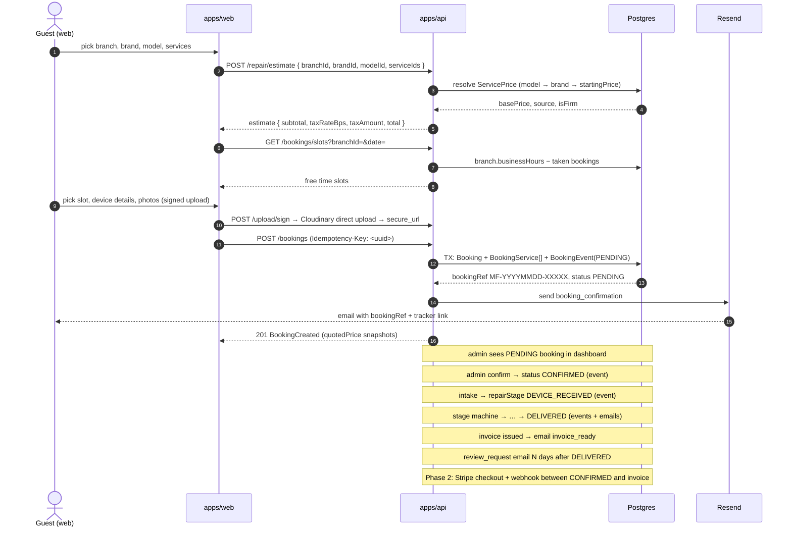
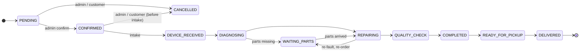
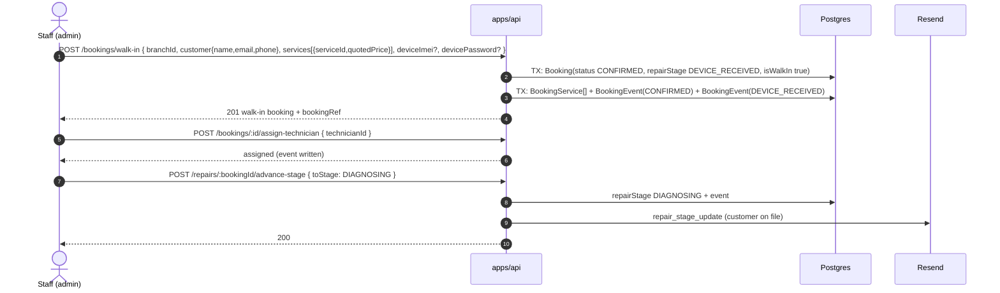
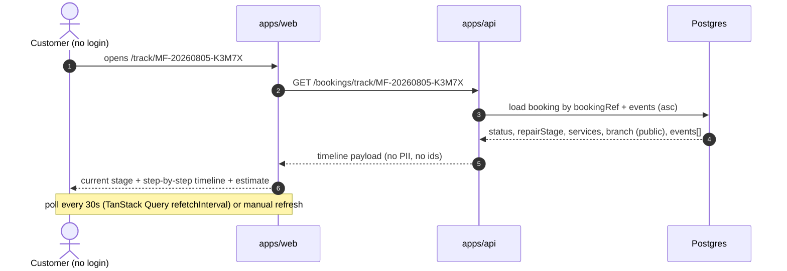
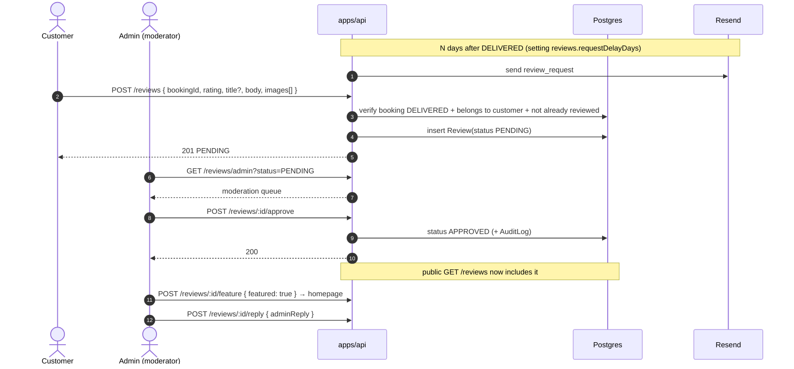
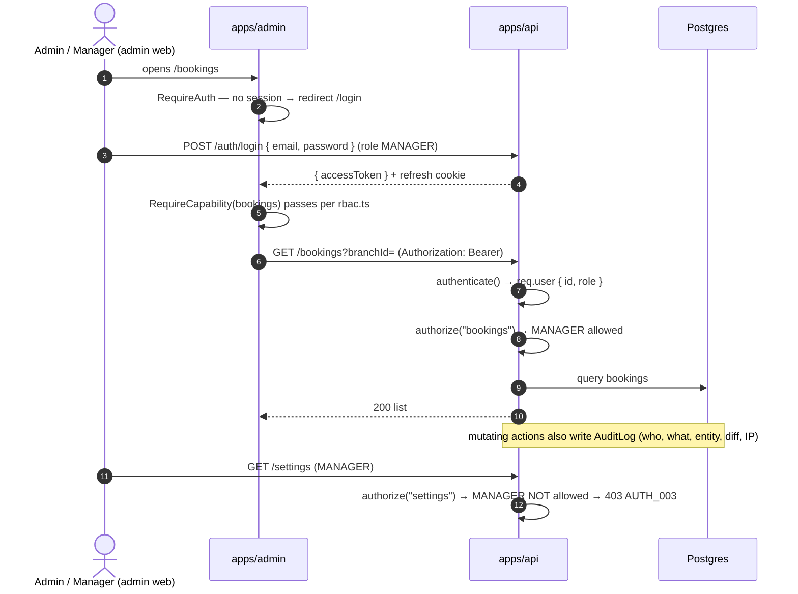

# Key Flows — MobileFix Pro

> End-to-end walkthroughs of the product's core flows with Mermaid diagrams and step lists.
> Companion docs: [api.md](api.md) (endpoint details), [architecture.md](architecture.md) §7.
> Endpoints referenced verbatim from [api.md](api.md). **Phase 2** items are marked — do not treat them as shipped.

---

## 1. Guest booking flow



**Steps**
1. **Estimate** — guest selects branch → brand → model → one or more services; `POST /repair/estimate` resolves each service from the `ServicePrice` matrix (exact model row → brand default → `Service.startingPrice` fallback) and returns firm or "from" pricing with tax.
2. **Slot availability** — `GET /bookings/slots?branchId=&date=` returns free slots derived from branch `businessHours` minus `PENDING`/`CONFIRMED` bookings for that `(branchId, date)`. A slot can't be double-booked (`409` on overlap).
3. **Create booking** — `POST /bookings` with `Idempotency-Key`; one transaction inserts `Booking` (status `PENDING`, `paymentStatus UNPAID`, generated `bookingRef`) + `BookingService[]` (with `quotedPrice` snapshots) + `BookingEvent` (`actorType: CUSTOMER`, `toStatus: "PENDING"`). Guests pass a `customer` object; logged-in users are linked via `Customer.id`.
4. **Confirmation** — Resend sends `booking_confirmation` within ~5s with the ref; replay of the same `Idempotency-Key` returns the original booking (`200`) instead of duplicating.
5. **Admin dashboard** — booking appears in `GET /bookings` (PENDING). Admin **confirms** → status `CONFIRMED` (event, optional `booking_confirmed` email).
6. **Intake** — at the counter, admin records device details (`PATCH /bookings/:id`: IMEI, serial, encrypted `devicePassword`), assigns technician, sets estimate, then `advance-stage` → `DEVICE_RECEIVED`. Every step writes a `BookingEvent`.
7. **Repair pipeline** — admin drives the stage machine (§2); each transition emits `repair_stage_update` email + `Notification`.
8. **Invoice** — on `COMPLETED`/`READY_FOR_PICKUP`, admin generates the invoice (§8); PDF emailed via `invoice_ready`.
9. **Review request** — N days after `DELIVERED` (setting `reviews.requestDelayDays`), `review_request` email goes out (§5). *(Phase 2: Stripe payment happens between intake and delivery.)*

---

## 2. Repair stage state machine

Two fields drive the lifecycle: `Booking.status` (`BookingStatus`: `PENDING` → `CONFIRMED` → `CANCELLED`) for the **booking lifecycle**, and `Booking.repairStage` (`RepairStage`) for the **pipeline once the device is in**. The tracker shows both.



### Allowed transitions

| From | To | Actor | Side effects |
|---|---|---|---|
| `PENDING` | `CONFIRMED` | ADMIN | event, notification |
| `PENDING` | `CANCELLED` | ADMIN / CUSTOMER | event, email `booking_cancelled` |
| `CONFIRMED` | `CANCELLED` | ADMIN / CUSTOMER | event, email `booking_cancelled` |
| `CONFIRMED` | `DEVICE_RECEIVED` | ADMIN | intake event, (invoice starts Phase 2) |
| `DEVICE_RECEIVED` | `DIAGNOSING` | ADMIN | event + email `repair_stage_update` |
| `DIAGNOSING` | `WAITING_PARTS` | ADMIN | event + email |
| `DIAGNOSING` | `REPAIRING` | ADMIN | event + email |
| `WAITING_PARTS` | `REPAIRING` | ADMIN | event + email |
| `REPAIRING` | `WAITING_PARTS` | ADMIN | event + email |
| `REPAIRING` | `QUALITY_CHECK` | ADMIN | event + email |
| `QUALITY_CHECK` | `COMPLETED` | ADMIN | event + email |
| `COMPLETED` | `READY_FOR_PICKUP` | ADMIN | event + email |
| `READY_FOR_PICKUP` | `DELIVERED` | ADMIN | event + email (terminal) |

- The API exposes the legal moves for the current stage: `GET /repairs/:bookingId/transitions`.
- `POST /repairs/:bookingId/advance-stage` **rejects** anything outside the table with `409 CONFLICT` + `details.allowed`; no silent skips across the chain.
- `CANCELLED` is reachable **only** from `PENDING`/`CONFIRMED` (before intake) — once the device is received, cancel is no longer offered.
- Every transition writes a `BookingEvent` (`actorType: ADMIN`, `fromStatus` → `toStatus`, `note`) and is mirrored in `AuditLog`.
- `WAITING_PARTS` is an optional pause (parts on order, inventory is Phase 2); it may be re-entered from `REPAIRING`.

---

## 3. Admin walk-in intake



**Steps**
1. Staff opens **New walk-in**; `POST /bookings/walk-in` creates the booking already `CONFIRMED` with `repairStage: DEVICE_RECEIVED` (`isWalkIn: true`) — the device is physically at the counter, no confirmation wait.
2. Unknown device → `brandId`/`modelId` omitted and an "OTHER"-style service used; this is the documented "no model found" handling (`FR-BOOK-04`).
3. Customer is found via `GET /customers?search=` and linked, or created on the fly with `POST /customers`.
4. Intake form captures device details (`PATCH /bookings/:id`): IMEI, serial, encrypted password (never returned by the API), problem description, notes.
5. Technician assigned from the branch's list (`POST /bookings/:id/assign-technician`).
6. Estimate set (`POST /bookings/:id/set-estimate`) → repair enters the pipeline at `DIAGNOSING` via `advance-stage`.

---

## 4. Public repair tracking



**Rules** (`FR-REPAIR-02`)
- Keyed by `bookingRef` (the high-entropy `MF-YYYYMMDD-XXXXX`), **never** the `cuid`. The ref is the bearer secret.
- Response excludes `customer` identity, `deviceImei`/`deviceSerial`, `devicePassword`, and internal `id`s — only what a tracker needs.
- Rate limited with the booking scope (20/10min/IP) to prevent scraping.
- Guest cancellation uses the same ref + a matching email (`POST /bookings/:bookingRef/cancel`).

**Steps**
1. Customer pastes the ref from the confirmation email (or the "Track" nav bar).
2. `GET /bookings/track/:bookingRef` returns `status`, `repairStage`, `estimatedCost`, `paymentStatus`, branch info, service names/`quotedPrice`, and the ordered `BookingEvent` timeline.
3. The UI renders a vertical timeline (`fromStatus → toStatus`, note, timestamp) with the current stage highlighted.

---

## 5. Review submission + moderation



**Steps**
1. **Eligibility** (`FR-REV-01`): a customer may review only a booking that is `DELIVERED`, belongs to their `Customer`, and has no existing `Review` (`Review.bookingId` is unique — 1 review per booking). Unverified users can book but not review.
2. Submit via `POST /reviews` (rating 1–5, up to 3 images via signed upload). New review is `PENDING`.
3. Moderator queues it via `GET /reviews/admin?status=PENDING` and **approves** (→ public) or **rejects** (hidden). Actions are audited.
4. Public list `GET /reviews` returns **only `APPROVED`**; `featured` reviews surface on the homepage.
5. `adminReply` is set by `POST /reviews/:id/reply` (`repliedById` recorded) and rendered under the public review.

---

## 6. Auth flows

### 6a. Register + email verification

```mermaid
sequenceDiagram
    autonumber
    actor C as Customer (web)
    participant A as apps/api
    participant DB as Postgres
    participant EM as Resend

    C->>A: POST /auth/register { email, password, name, phone? }
    A->>DB: create User(CUSTOMER) + Customer; generate EMAIL_VERIFICATION OTP
    A->>EM: email_verification (6-digit code)
    A-->>C: 201 { user, accessToken } + refresh cookie
    C->>A: POST /auth/verify-email { code }
    A->>DB: mark emailVerifiedAt (Otp consumed)
    A->>EM: welcome email
    A-->>C: 200 emailVerifiedAt
```

- Unverified users **can book but not review**.
- Resend via `POST /auth/resend-verification`; OTP attempts/expiry enforced server-side.

### 6b. Login + refresh rotation

```mermaid
sequenceDiagram
    autonumber
    actor C as Client (web/admin)
    participant A as apps/api
    participant DB as Postgres

    C->>A: POST /auth/login { email, password }
    A->>DB: verify bcrypt(passwordHash); issue refresh token (hash stored)
    A-->>C: 200 { user, accessToken } + Set-Cookie mfp_refresh (httpOnly, SameSite=Lax, Secure)
    Note over C,A: access token valid 15 min (JWT HS256, claims sub, role)
    C->>A: GET /me (Authorization: Bearer <accessToken>)
    A-->>C: 200
    Note over C,A: access token expires
    C->>A: POST /auth/refresh (mfp_refresh cookie)
    A->>DB: verify tokenHash, rotate: revoke old, store new
    A-->>C: 200 { accessToken } + Set-Cookie mfp_refresh (rotated)
    Note over C,A: reuse of a revoked token revokes the whole session family
```

### 6c. Forgot / reset password

```mermaid
sequenceDiagram
    autonumber
    actor C as Customer (web)
    participant A as apps/api
    participant EM as Resend

    C->>A: POST /auth/forgot-password { email }
    A-->>C: 200 { sent: true }   (always 200 — no account enumeration)
    A->>EM: password_reset (6-digit code, purpose PASSWORD_RESET)
    C->>A: POST /auth/reset-password { code, newPassword }
    A->>A: bcrypt(newPassword); bump passwordChangedAt → revoke ALL refresh tokens
    A-->>C: 200 { ok: true }
```

---

## 7. Admin login + RBAC capability check



**Capability table** — see [api.md](api.md) §4. MANAGER is granted bookings/repairs/invoices/customers/reviews/technicians/catalog/coupons/cms/analytics; **not** branches/settings/users/audit. ADMIN has all. `authorize()` is enforced on the API (not just hidden nav), so a direct request without the capability gets `403 AUTH_003`.

**Steps**
1. Route guard (`RequireAuth`) redirects unauthenticated users; API returns `AUTH_001/002` for missing/expired tokens.
2. `authenticate()` loads only `{ id, role }`; `authorize(capability)` maps role → capability from `packages/shared/rbac.ts`.
3. Every mutating admin call writes `AuditLog` (immutable, `GET /audit` ADMIN-only).
4. *(Phase 2: technician login reuses the same RBAC pipeline with the `TECHNICIAN` role; no technician auth exists in v1.)*

---

## 8. Invoice generation

```mermaid
sequenceDiagram
    autonumber
    actor M as Admin
    participant A as apps/api
    participant DB as Postgres
    participant EM as Resend
    participant CL as Cloudinary

    Note over A,DB: booking.status CONFIRMED, repairStage COMPLETED | READY_FOR_PICKUP
    M->>A: POST /invoices { bookingId }
    A->>DB: load booking + BookingService[] (quotedPrice snapshots)
    A->>DB: read branch tax.rateBps (default 1800); compute discount
    A->>DB: TX: insert Invoice (invoiceNo INV-YYYYMMDD-0001, status ISSUED, issuedAt) + event + AuditLog
    A->>CL: render + store PDF → pdfUrl
    A->>EM: invoice_ready (pdfUrl + bookingRef)
    A-->>M: 200 Invoice (subtotal, taxAmount, discount, total)
    Note over A,DB: payment is at the counter in v1 (PaymentStatus UNPAID)
    M->>A: POST /invoices/:id/mark-paid → status PAID, booking.paymentStatus PAID
```

**Steps**
1. **Eligibility**: booking must be `COMPLETED` or `READY_FOR_PICKUP`; one invoice per booking (`Invoice.bookingId` unique). Otherwise `409`.
2. **Amounts**: `subtotal` = Σ `BookingService.quotedPrice` (price snapshots at booking time); `taxAmount = round(subtotal × taxRateBps / 10000)`; `discount` from coupon/manual; `total = subtotal + taxAmount − discount`. All `Int` minor units.
3. **Numbering**: `invoiceNo` = `INV-YYYYMMDD-0001` — per-day zero-padded sequence, unique.
4. **PDF**: rendered server-side, stored on Cloudinary → `pdfUrl` (served from Cloudinary, not the API).
5. **Delivery**: `invoice_ready` email; `BookingEvent` + `AuditLog` written.
6. **Settlement (v1)**: payment at the counter; admin calls `mark-paid` (sets `Invoice.status PAID`, `Booking.paymentStatus PAID`). Void only from `DRAFT`/`ISSUED`. *(Phase 2: Stripe checkout + webhook drives `PaymentStatus` automatically; `PARTIAL`/`REFUNDED` states are pre-wired, unused in v1.)*

---

## Phase 2 markers (do not ship in v1)

- **Online payments** — `Booking.paymentStatus` / `Invoice.status` are pre-wired but **no checkout endpoints exist**; there is no Stripe webhook in v1. Payment happens at the counter.
- **Technician login** — no technician app, route, or `/auth` flow; technicians are admin-managed `Technician` records.

---

**Referenced by:** [architecture.md](architecture.md) §7, [PRD.md](PRD.md) §5. **Depends on:** [api.md](api.md) endpoints, [prisma/schema.prisma](../prisma/schema.prisma) enums (`BookingStatus`, `RepairStage`, `InvoiceStatus`, `ReviewStatus`).
